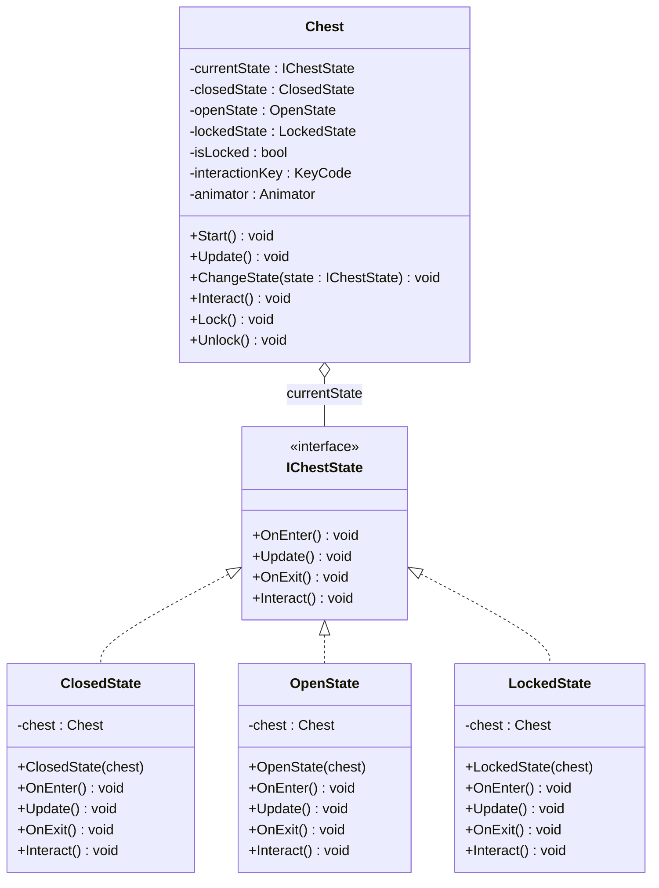
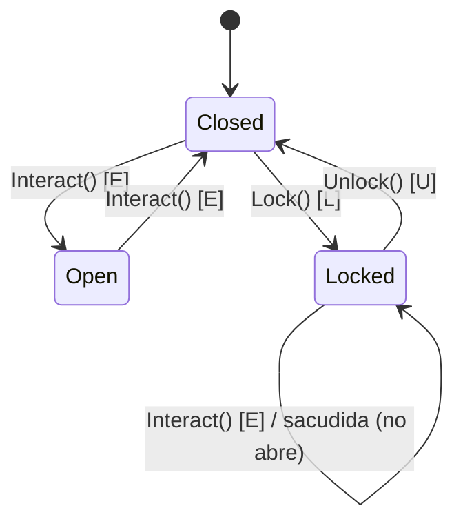

# Documento Técnico – Cofre Interactivo con Patrón State

**Universidad Católica de Cuenca – ICCIT**
**Carrera:** Realidad Virtual y Videojuegos
**Asignatura:** Programación Avanzada de Videojuegos
**Docente:** Ing. Jheyson Gaona, Mtr.
**Evaluación:** Interciclo – Ciclo 5, Paralelo A
**Estudiante:** _[Escribe aquí tu nombre completo]_
**Motor:** Unity 6000.6.2f1 (URP) – C#

---

## 1. Objetivo

Diseñar e implementar en Unity un **cofre interactivo** cuyo comportamiento está controlado por una **máquina de estados** basada en el **patrón de diseño State**. El cofre tiene tres estados: **Closed (Cerrado)**, **Open (Abierto)** y **Locked (Bloqueado)**, con transiciones según las acciones del jugador.

## 2. Estructura del proyecto

```
Assets/
└── Sebastian/
    ├── Animations/
    │   ├── Cofre.controller      (Animator Controller del cofre)
    │   ├── Cofre_Close.anim
    │   ├── Cofre_Lock.anim
    │   ├── Cofre_Unlock.anim
    │   └── Cofre_Denied.anim     (sacudida cuando está bloqueado)
    └── Scripts/
        ├── Chest.cs              (Contexto)
        └── State/
            ├── IChestState.cs    (Interfaz de estado)
            ├── ClosedState.cs
            ├── OpenState.cs
            └── LockedState.cs
Assets/Scenes/SampleScene.unity   (escena con el cofre integrado)
```

Todos los scripts están dentro del namespace `Sebastian` para evitar conflictos de nombres.

## 3. Diagrama de clases (UML)



## 4. Cumplimiento de los requerimientos

### 4.1 Interfaz `IChestState` (2 pts)
Archivo: `Assets/Sebastian/Scripts/State/IChestState.cs`

Define la estructura común que deben cumplir todos los estados:

| Método | Propósito |
|---|---|
| `OnEnter()` | Se ejecuta al entrar al estado (configura visuales/animación). |
| `Update()` | Lógica por frame del estado (lo llama `Chest.Update()`). |
| `OnExit()` | Se ejecuta al salir del estado (limpieza). |
| `Interact()` | Acción del jugador; cada estado decide qué hacer. |

### 4.2 Estados `ClosedState`, `OpenState`, `LockedState` (2 pts)
Cada estado es una **clase independiente** que implementa `IChestState` y recibe una referencia al contexto `Chest` por constructor.

| Estado | OnEnter | Interact | OnExit |
|---|---|---|---|
| **ClosedState** | Baja la tapa (`SetLid(false)`), color blanco. | Si no está bloqueado → cambia a `OpenState`. | Log de salida. |
| **OpenState** | Levanta la tapa (`SetLid(true)`), muestra el contenido. | Cierra el cofre → `ClosedState`. | Log de salida. |
| **LockedState** | Tapa cerrada, animación de bloqueo (`IsLocked = true`), color rojizo. | **Impide la apertura**: reproduce animación *Denied* (sacudida) y muestra mensaje. | Quita el visual de bloqueo (`IsLocked = false`). |

### 4.3 Clase `Chest` – Contexto (2 pts)
Archivo: `Assets/Sebastian/Scripts/Chest.cs`

- Guarda el estado actual en `currentState` (`IChestState`).
- En `Start()` **inicializa los tres estados** (`closedState`, `openState`, `lockedState`) y arranca en `ClosedState`.
- `ChangeState(IChestState newState)` ejecuta en orden:
  1. `currentState.OnExit()` del estado anterior,
  2. asigna el nuevo estado,
  3. `currentState.OnEnter()` del nuevo estado.
- `Update()` lee el input y delega `currentState.Update()`.
- Expone en el Inspector `currentStateName` e `isLocked` para depuración en tiempo real.

```csharp
public void ChangeState(IChestState newState)
{
    if (newState == null || newState == currentState) return;
    currentState?.OnExit();
    currentState = newState;
    currentStateName = newState.GetType().Name;
    currentState.OnEnter();
}
```

### 4.4 Transiciones e interacciones (2 pts)



| Tecla | Método | Comportamiento |
|---|---|---|
| **E** | `Interact()` | Delegado al estado actual: abre, cierra o intenta abrir (bloqueado). |
| **L** | `Lock()` | Solo bloquea si el cofre está **cerrado**; si está abierto avisa “Cierra el cofre antes de bloquearlo”. |
| **U** | `Unlock()` | Solo si está bloqueado → vuelve a `ClosedState`. |

La condición de seguridad está en dos niveles: `LockedState.Interact()` nunca cambia a `OpenState`, y `ClosedState.Interact()` además verifica `chest.IsLocked`.

### 4.5 Integración en Unity (2 pts)
- Se usó el modelo 3D de cofre *Animated PBR Chest* (carpeta `Assets/Animated PBR Chest Demo`).
- El componente `Chest` está agregado al cofre en `SampleScene`.
- Cambios visuales mediante **Animator** (`Cofre.controller`) con parámetros:
  - `IsOpen` (bool) → abrir/cerrar tapa.
  - `IsLocked` (bool) → animaciones de bloqueo/desbloqueo.
  - `Denied` (trigger) → sacudida al intentar abrir bloqueado.
- Alternativa por **transformación**: si se asigna `lid` en el Inspector, la tapa rota con `Quaternion.Slerp`.
- Cambio de color del cuerpo según el estado (rojizo = bloqueado).

## 5. Cómo probar

1. Abrir el proyecto con **Unity 6000.6.2f1**.
2. Abrir `Assets/Scenes/SampleScene.unity`.
3. Presionar **Play** y usar:
   - **E** → abrir / cerrar
   - **L** → bloquear (estando cerrado)
   - **U** → desbloquear
4. Verificar en la **Consola** los mensajes de `OnEnter/OnExit` y en el Inspector del cofre el campo `Current State Name`.

## 6. Evidencias

_(Agregar capturas en la carpeta `Evidencias/` y enlazarlas aquí)_

| Estado | Captura |
|---|---|
| Closed | `Evidencias/closed.png` |
| Open | `Evidencias/open.png` |
| Locked | `Evidencias/locked.png` |
| Consola (transiciones) | `Evidencias/consola.png` |

## 7. Conclusión

El patrón State permitió separar el comportamiento de cada estado del cofre en clases independientes, eliminando condicionales grandes (`if/switch`) dentro de `Chest`. Agregar un nuevo estado (por ejemplo, *Destroyed*) solo requiere crear una nueva clase que implemente `IChestState`, sin modificar los estados existentes, lo que hace el código modular, reutilizable y fácil de mantener.
